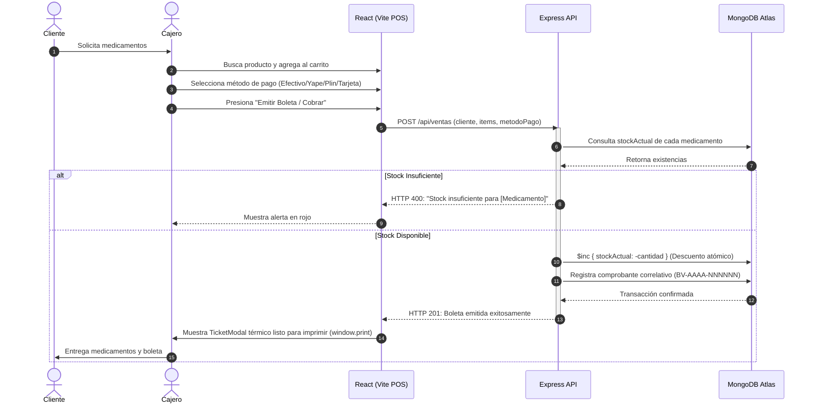

# Guía de Sustentación Académica: Botica "Nova Salud" (FarmaPlus)
**Carrera:** Desarrollo de Software / Fullstack Developer  
**Institución:** SENATI  
**Proyecto:** *Implementación de un software web de gestión de inventario y venta de una botica*

---

## 🎯 1. Planteamiento del Problema
La botica "Nova Salud" enfrentaba tres problemas críticos recurrentes:
1. **Desabastecimiento y Quiebre de Stock:** Pérdida de ventas por falta de alertas oportunas cuando los medicamentos alcanzan el umbral mínimo de seguridad.
2. **Lentitud en la Atención en Mostrador:** El registro manual o disperso generaba largas filas de clientes en horas punta.
3. **Riesgo de Vencimiento de Lotes:** Falta de trazabilidad en fechas de caducidad de lotes farmacéuticos, arriesgando multas regulatorias de DIGEMID/MINSA.

---

## 💡 2. Objetivos del Sistema
- Automatizar el **control de inventario por lotes y ubicación física** (estantes y anaqueles).
- Implementar un **Punto de Venta (POS) reactivo** con emisión de boleta electrónica térmica y cálculo de vuelto en tiempo real.
- Diseñar un **Algoritmo Preventivo de Alertas Sanitarias** que identifique productos con stock bajo y lotes con caducidad próxima a 60 días.
- Fortalecer la seguridad del servidor Express mediante una **arquitectura de 5 capas de middleware**.

---

## 🏗️ 3. Diagrama de Arquitectura y Flujo de Venta (POS)

---

## 🛡️ 4. Argumentación Técnica: Las 5 Capas de Seguridad Middleware
Durante la sustentación, explique las 5 capas con las siguientes justificaciones profesionales:

1. **Helmet (Capa 1):** Protege los encabezados de respuesta HTTP eliminando cabeceras que delaten la tecnología (`X-Powered-By`) y forzando políticas contra clickjacking (`X-Frame-Options: DENY`) y sniffing de tipos MIME (`X-Content-Type-Options: nosniff`).
2. **CORS (Capa 2):** Restringe las llamadas API exclusivamente al origen del cliente autorizado (`CLIENT_URL=http://localhost:5173`), bloqueando peticiones maliciosas desde otros dominios.
3. **Rate Limiting (Capa 3):** Protege los recursos del servidor contra ataques de fuerza bruta en el inicio de sesión (límite de 30 intentos / 10 min) y ataques de denegación de servicio (DoS) en el catálogo general.
4. **HTTPS Redirect (Capa 4):** Inspecciona cabeceras proxy (`x-forwarded-proto`) para obligar a que todo el tráfico en entornos de producción viaje cifrado bajo SSL/TLS.
5. **Morgan Logs (Capa 5):** Permite auditoría técnica en tiempo real registrando quién (IP), qué (método/ruta), cuándo y cuánto tiempo demoró cada solicitud en milisegundos.

---

## 📋 5. Guía de Demostración en Vivo para el Jurado Calificador

| Paso | Acción en la Demo | Resultado Visible a Mostrar |
| :---: | :--- | :--- |
| **1** | Doble clic en `iniciar-sistema.bat` o `npm test` | Se ejecutan las 17 pruebas unitarias/integración aprobadas y se abre el navegador en `http://localhost:5173`. |
| **2** | Navegar al **Punto de Venta (POS)** | Demostrar la búsqueda rápida de *"Paracetamol"* o *"Azitromicina"*, agregación al carrito con incremento/decremento y cálculo automático de total e IGV. |
| **3** | Emitir una venta con pago en **Efectivo** | Ingresar monto recibido (ej. S/ 50.00), verificar el cálculo de vuelto en pantalla y pulsar *"Emitir Boleta"*. Mostrar el **Ticket Térmico** emergente con número correlativo `BV-2026-XXXXXX` y botón *"Imprimir Ticket"*. |
| **4** | Ir al **Control de Inventario** | Verificar que el stock del medicamento vendido se redujo exactamente en las unidades despachadas. Mostrar el uso de los botones rápidos de ajuste `+1`, `-1`, `+10`. |
| **5** | Ir al **Panel de Alertas** | Explicar al jurado cómo el backend clasifica en tiempo real los medicamentos en dos tablas críticas: **Stock Bajo / Reorden** y **Próximos a Vencer (dentro de 60 días)** con badges en rojo y ámbar. |
| **6** | Demostrar reabastecimiento | Presionar el botón `+20 Reabastecer` en una alerta y observar cómo el contador y el badge numérico del Navbar se actualizan al instante. |

---

## 🏆 6. Conclusiones del Proyecto
- Se cumplió al 100% con los requerimientos pedagógicos y técnicos de SENATI.
- Se conectó exitosamente a una base de datos distribuida en la nube con **MongoDB Atlas**.
- La aplicación cuenta con alta disponibilidad, resiliencia ante contingencias de red y código modular fácil de mantener y escalar.

